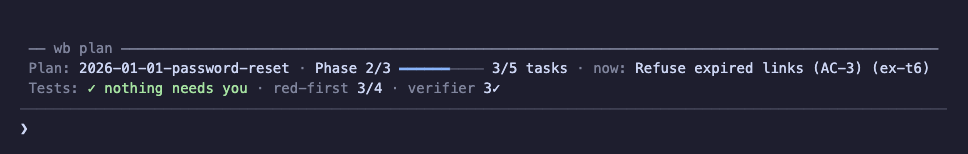
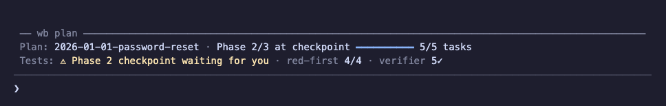
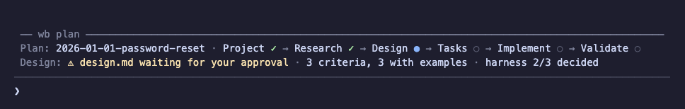
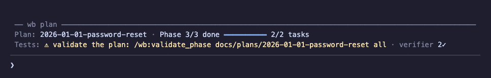
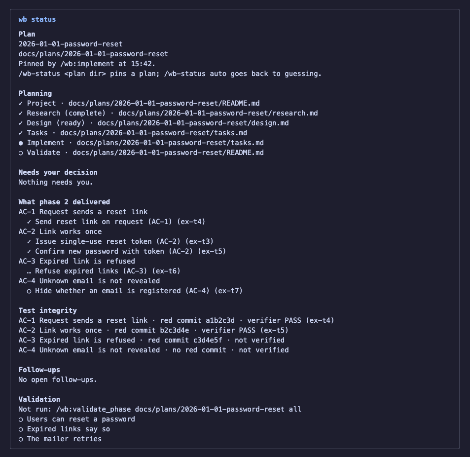

# Workbench (wb)

A Claude Code plugin for structured software development workflows: project planning, research, design, execution, and validation with TDD enforcement and beads integration.

## Overview

A personal workbench of tools and workflows for Claude Code. Streamlines software development through structured planning, research, and persistent task tracking with [beads](https://github.com/steveyegge/beads).

**[Complete Workflow Guide](docs/workbench-workflow-guide.md)**

## Quick Start

### Installation

```bash
# Add the marketplace and install the plugin
claude plugin marketplace add gvarela/workbench
claude plugin install wb@gvarela-workbench
```

> **Using the pre-2.0 version?** The final 1.x release (v1.1.0, old `commands/` layout, pre-embedded-Dolt beads) lives on the [`1.x` branch](https://github.com/gvarela/workbench/tree/1.x). It receives critical fixes only — see [RELEASING.md](RELEASING.md) and the [2.0.0 migration notes](CHANGELOG.md) before upgrading.

For local development:

```bash
# Clone and test locally (changes take effect immediately)
git clone git@github.com:gvarela/workbench.git
claude --plugin-dir /path/to/workbench/plugin
```

### Updating

To release new commands/skills/agents:

1. Bump `version` in **both** `plugin/.claude-plugin/plugin.json` and `.claude-plugin/marketplace.json` (must match)
2. Commit and push to GitHub
3. Users run from their shell (not a slash command):

   ```bash
   claude plugin update wb@gvarela-workbench
   ```

4. Restart Claude (or `/reload-plugins`) to apply

Note: `/reload-plugins` alone does NOT pull updates — the cache is keyed by version and only `claude plugin update` invalidates it.

### Permissions for Planted-Defect Checks

`task-verifier` and `test-reviewer` check that a test can fail by breaking the code in a disposable git worktree at `/tmp/wb-defect-<id>` and running the test there. Claude Code treats the in-place `sed` that makes the break as a file edit, so allow these rules (in `~/.claude/settings.json` or the project's `.claude/settings.json`) or the check is reported under Not Run:

```json
{
  "permissions": {
    "allow": [
      "Bash(git worktree:*)",
      "Edit(//tmp/wb-defect-*/**)",
      "Edit(//private/tmp/wb-defect-*/**)"
    ]
  }
}
```

The last rule is for macOS, where `/tmp` resolves to `/private/tmp`. The agents still have no Edit tool; the rule only lets their `sed` touch the disposable copy.

### Using Commands

```bash
# Initialize -> Research -> Design -> Implement -> Validate
/wb:create_project my-feature docs/plans TICKET-123
/wb:create_research docs/plans/2025-01-15-TICKET-123-my-feature
/wb:create_mockup docs/plans/... "UI component"  # Optional for UI
/wb:explore_design docs/plans/...  # Optional for big architecture decisions
/wb:create_design docs/plans/...
/wb:create_tasks docs/plans/...
/wb:implement docs/plans/...
/wb:validate_phase docs/plans/... all  # Also runs automatically at the last checkpoint
```

**Skills** (auto-activated): `project-structure`, `doc-adherence`, `tdd-discipline`, `verification-before-completion`, `status-sync`. `mockup-iteration` and `review-prep` run when you or the model invoke them.

Auto-activation depends on the model electing these skills, which in practice happens rarely inside workflow-command sessions. During coordinated execution the discipline is guaranteed structurally instead: task-workers preload `tdd-discipline` and every task passes through `task-verifier`. The auto-activated skills primarily protect **solo and ad-hoc** changes made outside the workflow commands.

**[Full Commands Reference](docs/commands-reference.md)**

## Status Band (optional `wb-status` mod)

`wb-status` is a separate, optional plugin in the same marketplace. It draws a two-line band above the prompt that shows where your plan stands and whether anything needs you, so you do not have to run `/wb:help` or `bd` to find out. It is a prototype built on Claude Code's [mods API](https://code.claude.com/docs/en/plugins/mods/overview), which is early access, so it can change between Claude Code releases.

### Install

```bash
# Once the marketplace is added (see Installation above)
claude plugin install wb-status@gvarela-workbench
```

Then restart Claude Code, or run `/reload-plugins` in a running session. To try it for one session from a checkout instead: `claude --plugin-dir ./mods/wb-status`.

It is read-only: it never writes to your repository or to beads, and never approves or denies a tool call. Install it at user scope (the default) so it shows in every repository; a project- or local-scope install shows only in that one.

### What it shows

**While a phase runs**: the plan, the phase, task progress, and the task in flight; on the second line, whether anything needs you, how many acceptance criteria have their red-first commit, and the task verifier's verdicts.



**When a phase reaches its checkpoint**: the band says the checkpoint is waiting for you.



**While planning** (project, research, design, tasks): the stage chain, with done, current, and not-started stages, and the current stage's signals, such as a design waiting for your approval.



**When the plan is done but not validated**: it reminds you to run `/wb:validate_phase <plan-dir> all`. Once validation has written its verdicts into the plan's README, the reminder goes away, and a failed verdict shows as a warning instead. Open questions the plan handed off show as dim follow-ups, not warnings.



**The `/wb-status` pane** has the detail behind the band: which plan it picked and why, the planning stages and their files, what needs your decision, what the phase delivered per acceptance criterion, test integrity, follow-ups, and the validation verdicts.



The images are rendered from the mod's own band and pane code with a demo plan.

### Which plan, and choosing one

The band follows the plan your latest `/wb:*` command named, including plans that live in a git worktree. Without one, it guesses from recent beads activity and marks the plan `(guessed)`. `/wb-status <plan-dir>` pins a plan by hand, and `/wb-status auto` goes back to guessing.

### Reading log (off by default)

To compare what the band showed with the session transcript, turn on the reading log: run `/config` and set `wb-status.log` to true, or add this to `~/.claude/settings.json`:

```json
{"pluginConfigs":{"wb-status@gvarela-workbench":{"options":{"log":true}}}}
```

Logs go to `~/.claude/wb-status/logs/<session id>.jsonl`, capped at about 1 MiB per session, and logs older than 14 days are removed.

Full details, including the status-line fallback for VS Code and known limits: [mods/wb-status/README.md](mods/wb-status/README.md).

## What's Inside

### Commands (`/wb:*`)

Slash commands for project documentation and task management:

- **`/wb:create_project`** - Initialize structured documentation with rich metadata
- **`/wb:create_research`** - Document codebase using parallel research agents
- **`/wb:create_mockup`** - Research UI patterns and create HTML mockups with visual validation
- **`/wb:explore_design`** - Explore architecture directions and record the decision (optional)
- **`/wb:create_design`** - Create architectural design decisions (WHAT and WHY)
- **`/wb:create_tasks`** - Transform design into phased execution plan (HOW)
- **`/wb:implement`** - Implement the plan with coordinated worker agents (the default execution path); each outer test is committed as `red(AC-n)` first, and each phase checkpoint adds a test review
- **`/wb:implement_inline`** - Implement the plan inline in this session with TDD, with the same outer tests and checkpoint test review
- **`/wb:validate_phase`** - Check one phase, or the whole plan with `all`, against design.md and the README's Intent: deviations, earlier phases' tests, a test review, and a verdict per success statement. Each checkpoint already runs these checks; use it after fixes, after merging other work, or on an older plan
- **`/wb:validate_project`** - Repair tool, not a stage: check a plan's documents (files, frontmatter, beads ids, status) when they look inconsistent
- **`/wb:create_handoff`** - Create session handoff for work continuity
- **`/wb:resume_handoff`** - Resume from handoff document
- **`/wb:update_status`** - Intelligently sync status across all documentation files
- **`/wb:test-audit`** - Audit an existing test suite cold, with no plan, and report proposed Remove, Rewrite, and Consolidate verdicts (outside the stage chain)
- **`/wb:testing-profile`** - Draft `.claude/wb/testing.md`, the repository's testing conventions and team choices, after you confirm (outside the stage chain)
- **`/wb:help`** - Quick reference for all commands

### Agents

Specialized agents for codebase analysis:

- **`codebase-locator`** - Find specific components and files
- **`codebase-analyzer`** - Analyze implementation details with file:line references
- **`pattern-finder`** - Find similar patterns and implementations
- **`research-validator`** - Check a research document's paths, snippets, and claims against the code
- **`task-worker`** - Implement exactly one beads task with TDD under `/wb:implement`; never edits tests, apart from the support code a harness task delivers
- **`task-verifier`** - Verify task completion against requirements; runs `test-integrity` first and plants a defect to check that changed tests can fail
- **`phase-verifier`** - At each phase checkpoint, compare the phase's tasks with its diff (planned changes missing, changes nobody planned), list earlier phases' tests the phase changed, and report progress on each Intent success statement; edits nothing
- **`test-writer`** - Write the tests for a task (an outer acceptance test per criterion, or inner unit tests a worker or the inline session asks for), with proof that any new harness works, and nothing else
- **`test-reviewer`** - Review a phase's tests against the `test-quality` rubric at each checkpoint; proposes findings, edits nothing
- **`test-auditor`** - Audit one area of an existing suite cold, for `/wb:test-audit`; edits nothing

### Skills (auto-activated)

Background capabilities that Claude automatically invokes:

- **`project-structure`** - Enforces document separation (research.md, design.md, tasks.md)
- **`doc-adherence`** - Requires claims about a plan document to come from a read of that file in the current context
- **`tdd-discipline`** - Enforces RED-GREEN-REFACTOR cycle before writing production code, with a named list of exceptions
- **`test-quality`** - The shared rubric for whether a test can fail and is worth keeping; preloaded by the testing agents
- **`verification-before-completion`** - Requires running verification before claiming work is done
- **`status-sync`** - Monitors for status drift and reminds to sync

Invoked by you (or by the model when you ask for it):

- **`mockup-iteration`** - Iterate on UI mockups with KEEP/REMOVE/CHANGE tracking
- **`review-prep`** - Interactive code review walkthrough using tmux and nvim

### Hooks

- **SessionStart** - `wb-prime.sh`: orientation on startup, resume, clear, and fork (stage chain, plan layout, the beads sanity check, active plans); recovery text on compact. Override with `.claude/wb/PRIME.md`; print the default with `hooks/wb-prime.sh --export`
- **PreCompact** - `wb-prime.sh` is also registered here, but PreCompact output never reaches the model or the summary; the recovery text arrives through SessionStart's `compact` source
- **SessionEnd** - Reminds to `bd dolt push` only when a Dolt remote is configured (silent otherwise)
- **PostToolUse** - Lints markdown files after Write/Edit operations

## Plugin Structure

```
workbench/
├── .claude-plugin/     # Marketplace manifest (source: ./plugin)
├── plugin/             # The shipped runtime — the only thing installs cache
│   ├── .claude-plugin/plugin.json
│   ├── skills/<name>/SKILL.md   # /wb:* workflow commands + background capabilities
│   ├── agents/         # Specialized subagents
│   ├── hooks/          # Event handlers
│   ├── scripts/        # Utility scripts (lint, test-integrity)
│   └── docs/reference/ # Runtime-referenced shared docs
├── tests/              # Tests for the shipped scripts (not shipped)
└── docs/               # Maintainer guides + project plans (not shipped)
```

## Beads Integration

Requires [beads](https://github.com/steveyegge/beads) 1.1.0 or later for persistent task tracking (the supported version, the bd contract the plugin relies on, and the upgrade protocol are in [docs/beads-guide.md](docs/beads-guide.md)):

```bash
bd init --stealth   # any repository with collaborators who do not use beads (writes the shared .git/info/exclude)
bd init             # only a repository you own outright; .beads/ is still excluded, never committed
```

Commands create and track beads issues for phases, tasks, and UI questions. The local Dolt database is the source of truth; a Dolt remote or `bd backup` carries it across machines. Setup rule, persistence tiers, worktrees, the session-start sanity check, and hygiene: `plugin/docs/reference/beads-mode.md`.

## Core Philosophy

- **Document, Don't Judge**: Research describes what EXISTS, not what should change
- **Explicit Barriers**: Synchronization points prevent rushing ahead
- **Dual Verification**: Automated (tests, CI) + Manual (UX, edge cases)
- **Zero Scope Creep**: Tasks only from plans - no ad-hoc additions

## Development

### Linting

```bash
./plugin/scripts/lint           # Lint changed files
./plugin/scripts/lint --fix     # Auto-fix issues
./plugin/scripts/lint --all     # Lint all markdown files
```

### Testing Changes

```bash
# Run with local plugin (point at the plugin/ subdirectory)
claude --plugin-dir /path/to/this/repo/plugin

# Reload after changes (inside Claude Code)
/reload-plugins
```

### Trying an Unreleased Branch in Real Projects

`--plugin-dir` covers one session. To run a branch in every session, in other repositories, and as an installed plugin (which `--plugin-dir` does not exercise), point the local marketplace at a pinned snapshot worktree of the branch. A snapshot keeps in-progress edits in your working copy out of the sessions that are testing it.

```bash
# 1. Create a snapshot worktree pinned to a commit on the branch
git -C /path/to/workbench worktree add --detach /path/to/wb-snapshot <commit>

# 2. Point the marketplace at the snapshot and reinstall the plugin
claude plugin marketplace remove gvarela-workbench
claude plugin marketplace add /path/to/wb-snapshot
claude plugin install wb@gvarela-workbench
claude plugin list          # wb@gvarela-workbench should read from /path/to/wb-snapshot/plugin
```

Restart Claude (or `/reload-plugins`) in open sessions. Every new session now uses the snapshot.

To move the snapshot to a newer commit, do it between sessions:

```bash
git -C /path/to/wb-snapshot checkout --detach <newer-commit>
claude plugin marketplace update gvarela-workbench
```

To go back to the released plugin, re-add the original source and reinstall:

```bash
claude plugin marketplace remove gvarela-workbench
claude plugin marketplace add gvarela/workbench      # or your local clone's path
claude plugin install wb@gvarela-workbench
git -C /path/to/workbench worktree remove /path/to/wb-snapshot
```

Removing the marketplace also removes the plugin's saved options.

## License

MIT
