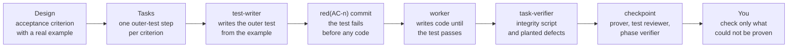
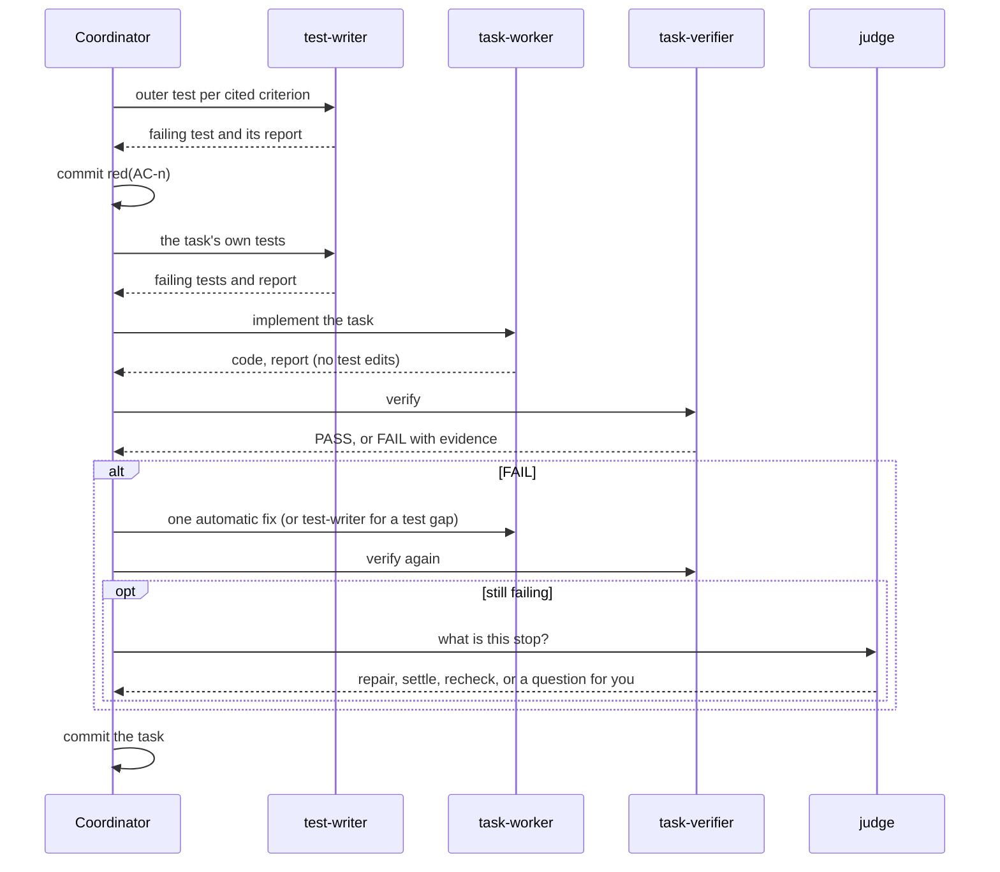
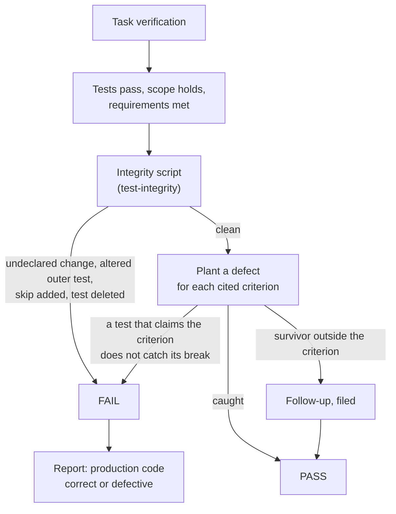
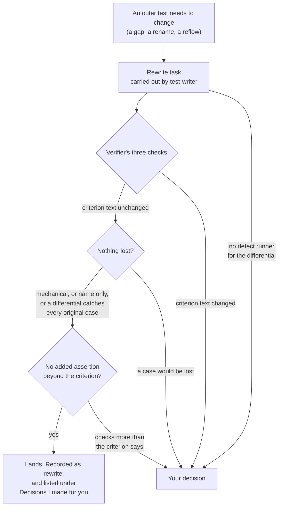
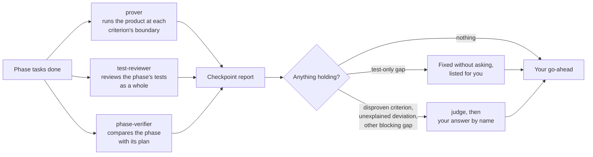

# How testing works in wb

wb treats a passing test suite as a claim that needs evidence. This document explains what that evidence is, who produces it, and what it costs. It describes wb 5; for what changed from wb 4, see [Upgrading from wb 4 to wb 5](upgrading-to-5.md).

## The idea in one page

Three things make a green suite untrustworthy when an agent writes the code:

- **The author writes the check.** A test written by the code's author, after the code, tends to pass whatever the code does.
- **Tests get bent.** When a test fails, the cheapest fix is often to the test: loosen an assertion, skip it, compute the expected value from the code.
- **Passing tests are not a working product.** A test can pass while the product's real entry point never reaches the code it tests.

wb answers each with a separation of duties and a piece of evidence:

| Problem | Who is kept apart | Evidence |
| --------- | ------------------- | ---------- |
| The author writes the check | `wb:test-writer` writes every test; workers write code only | A failing test committed before the code: `red(AC-n)` |
| Tests get bent | `wb:task-verifier` checks every test change against what was declared | The `test-integrity` script's report, and planted defects |
| Passing is not working | `wb:prover` runs the product itself | The command it ran and the output it saw, per criterion |

Three authorities decide three kinds of question, and none decides another's:

- **Scripts decide integrity.** Whether a test file changed, whether an outer test still matches its red commit, whether a skip marker appeared. These are facts from git.
- **A judge decides test adequacy, inside stated limits.** Whether a finding falls inside a criterion, whether one more fix attempt is warranted.
- **You decide the product.** What a criterion means, whether to accept lost coverage, whether a disproven criterion is fixed or accepted.

## From criterion to proof

A test begins as a sentence you approve at design and ends as a product run you can read.

Each stage adds one thing:

- **Design** writes each acceptance criterion as Given, When, Then, with a real example, where the result is observed, how it will be proven in the running product, and what it guards against. It also decides, per boundary, whether a test harness exists or must be added.
- **Tasks** gives every criterion an outer-test step, and every implementation task the criteria it serves.
- **Implementation** produces the red commit, the code, and the verification.
- **The checkpoint** shows the product doing what the criterion says.

## Two kinds of test

- **An outer test** checks one acceptance criterion at the boundary where you would observe it: a page, a response, a command's output, a stored record. It is the plan's check of what you approved. There is one per criterion.
- **A task's own tests** are the unit-level tests a task needs beyond its outer tests: an edge the examples name, a failure path, a unit the task adds.

Both are written by `wb:test-writer`. Outer tests carry more protection, because they stand for something you signed off.

## Red before green

The outer test is written from the criterion's text and example alone. The test-writer does not read the implementation to decide what to expect, so the test says what you approved and not what the code happens to do.

A valid red is a failure whose cause is that the behavior is not built yet:

- **An assertion red**: the test reached its assertion and failed on the intended behavior.
- **A not-built red**: the run stopped because code the plan creates does not exist yet, such as a missing class or method. No stub is written to turn this into an assertion failure. The worker notes the assertion failure it sees while building, and the verifier later shows the assertion can fail.

A syntax error in the test, a missing helper or fixture, a failed setup, or an error in existing code is not red.

Each outer test is committed on its own as `red(AC-n): <criterion title>` before the code that satisfies it. The commit is the record that the test came first, and it is the baseline every later check compares against.

## One task, start to finish

A few rules hold throughout:

- **Workers never edit tests.** A worker that needs another test stops and returns a request; the coordinator has the test-writer write it.
- **Workers spawn nothing.** The coordinator brokers every hand-off, so each agent's report is on record before the next one starts.
- **Reports live in beads.** The test-writer's reports, the worker's report, and the verifier's records are comments on the task, so a resumed session, the reviewer, and `validate_phase` read the same evidence.
- **`/wb:implement_inline` follows the same rules** for tests: the session writes code, and the test-writer writes every test. It has no per-task verifier, so its checkpoint review checks integrity across the phase.

## What the verifier checks

**Integrity, by script.** `plugin/scripts/test-integrity` reads git and reports, as facts:

- test files changed since the task began;
- whether each outer test is unchanged since its red commit;
- skip or focus markers added;
- test files deleted and test definitions removed;
- changed test files that no test-writer report declares.

The script decides nothing. The verifier reads its output and fails the task for an undeclared test change, an outer test altered without proof, or a skipped or deleted guard. A purely mechanical change, such as an import re-sort, is cleared with a note.

**Protection, by planted defect.** A passing test shows only that it runs. To show it protects its criterion, the verifier plants a small, realistic break in the production code, in a disposable copy, and runs the guarding test:

- an off-by-one at a boundary, a changed constant, a dropped filter;
- one control per target, to show the runner itself works;
- never in the working tree, which the coordinator commits as it stands.

A test that claims to guard a criterion and survives a break of that criterion fails the task. A survivor outside the criterion's statement and examples is filed as a follow-up: the gate checks that tests protect what you approved, not every behavior the code has.

**Always a failure**, whatever else is true, because each is how a test gets bent to pass:

- an expected value computed by calling the code under test;
- a loosened assertion, shown by a realistic break to accept wrong behavior;
- a test shown unable to fail;
- a skipped or deleted guard;
- an undeclared test change;
- an outer test changed after its red commit without proof.

Every failure cites a file and line and carries proof. The verifier also says whether the production code is correct, because most failures are test gaps on correct code, and those take a different route.

## Planted defects and the runner

The verifier, the test reviewer, and the test-writer take the first route that can run:

1. **`wb-plant-defect`**, from the optional `wb-defects` plugin. It plants one defect per call in a disposable copy and runs only the guarding test file.
2. **The repository's own mutation tool**, when `.claude/wb/testing.md` names a recognized one with its exact command.
3. **Not Run.** The check is reported as not run, with the reason, and protection is judged by reading. Reports show "N run, M survived, K not run", so a check that could not run is visible.

Every planted defect is recorded in a **defect ledger** on the task: the test, the target, both file hashes, what was broken, and the outcome. The checkpoint's test review skips a defect the ledger already shows on unchanged code.

## When an outer test has to change

An outer test is the plan's check of a criterion you approved. After its red commit it changes only through a rewrite task, and the change lands on evidence, not on anyone's say-so.

The differential is the heart of it: one defect is planted for each case the original test caught, and both versions are run against each. The rewrite must catch all of them. What a criterion means stays yours to decide; whether a changed test still checks it is a question evidence answers.

## The phase checkpoint

When a phase's tasks are done, three agents run in parallel before you are asked for a go-ahead.

- **`wb:prover`** works from the criterion, states what it expects before reading the implementation, and uses the product's own entry point: the command, the request, the page. Each criterion and manual check comes back proven, disproven, or could not prove, with the commands and output. Running the criterion's test is not this step. Where the tests stub an outside service, it lists what that service was assumed to accept.
- **`wb:test-reviewer`** reviews the phase's tests against the shared rubric, with the criteria, red commits, and ledgers in hand. It plants defects only where no ledger covers them and edits nothing.
- **`wb:phase-verifier`** reports planned changes missing from the diff, changes no task covers, earlier phases' tests changed again, and progress toward each Intent statement.

**What holds the go-ahead:**

- a deterministic failure in a test the phase changed: a criterion with no outer test, a changed outer test with no proof, an undeclared test change, a test that cannot fail, or a planted defect that survives a test claiming to guard its criterion;
- a criterion or manual check the prover disproved;
- a deviation from the plan that no record explains;
- on the final phase, a failed Intent verdict.

A blocking test gap whose fix changes tests only is closed without asking and listed under "Decisions I made for you". Everything else that holds needs your answer by name, such as `fix: P1` or `accept: D2`. Judgment-only findings are advisory, and tests the phase did not change never block.

**What you check by hand** is "Left for you to check": only what the prover could not prove, each with its reason and the steps.

## The rubric everyone shares

The test-writer, the verifier, the reviewer, and the auditor all read one rubric, the `test-quality` skill, so the rules a test is written to are the rules it is judged by. It asks one question first and four after.

**Can this test fail?**

- It has an assertion on the behavior, not on a mock or its own setup.
- No assertion is always true.
- It is not skipped or focused without a stated reason.
- Every "not present" or "all match" assertion has a positive anchor, since both pass on an empty result.
- A planted break of its criterion makes it fail.

**Is it worth keeping?**

- **Behavioral**: expected values come from the criterion's example or another independent source, never from the code under test.
- **Structure-insensitive**: it asserts on observable state, not on which calls were made or on source text, and uses test doubles only at the criterion's declared seam.
- **Specific**: one behavior per test, so a failure points at the cause.
- **Predictive**: it runs at the level the criterion is observed, covers the real data shapes the plan names, and does not depend on the clock or test order.

A finding gets a verdict of Remove, Rewrite, or Consolidate, and a hard verdict follows only from proof: a detector or diff, a surviving planted defect, or a counterexample. Pattern rules prompt a check; they are not proof on their own.

## Your repository's conventions

- **Research** records the repository's Testing Conventions as facts: frameworks, commands, the harness that exists at each boundary, seams, skip markers, and installed tooling.
- **`/wb:testing-profile`** drafts `.claude/wb/testing.md`, written only when you confirm. It holds the same conventions plus your team's Choices (for example "no browser tests", or "stub the model at the call"), a mutation level, how to run the defect sandbox, and a Proof section telling the prover how to start the product and which side effects are allowed.
- **A Choice bounds the findings.** A reviewer leaves out a finding that only repeats an absence a Choice records. A Choice never clears a deterministic failure.
- **When a written rule and the existing tests disagree**, the rule wins for a new test and the old tests are left alone. See "Conflicting guidance" in the plugin's rules reference.

## Auditing tests you already have

`/wb:test-audit [scope] [N | full]` reviews an existing suite cold, with no plan.

- It ranks tests by suspicion first, using the project's own detectors and read-only heuristics, and inspects the top candidates per area.
- Before it spends anything, it states the scope, how many `wb:test-auditor` agents it will run, and a cost class. On a large repository it asks you to confirm or narrow.
- It writes a report of proposed Remove, Rewrite, and Consolidate verdicts with evidence for a person to spot-check. It never edits or deletes a test.

## Plans written before wb 5

A plan whose design.md has no Acceptance Criteria section has no outer tests: `implement` says so and makes no `red(AC-n)` commits. The rest holds. Workers still never edit tests, the task's tests still come from the test-writer, the verifier still checks integrity, and checkpoints still run all three agents.

## What it costs

From fifteen sessions on two projects:

- **About a third of tasks are verified twice.** Most verifier failures are test gaps on code that was correct, not production defects.
- **The verifier is about half of all agent time**, at roughly 7 minutes a run before it moved to medium effort. In blind trials with seeded defects, medium effort caught the same 12 of 12 as high effort in a quarter to nearly half less time.
- **Outer tests are rewritten often.** In one repository about half of the red commits were rewrites. They land on proof and cost agent time, not yours.

These are proportions from mixed Rails and Python work on alphas that changed during the period, not a quote.

## Limits

- **Without a defect runner**, protection is judged by reading, and a not-built red has only the worker's note to show its assertion can fail.
- **The evidence is narrow.** Blind trials used seeded test-integrity defects on a small fixture. They show the verifier catches those; they do not measure how often it misses a subtle production bug in a large change.
- **A stub hides an assumption.** The prover lists what a stubbed service was assumed to accept, but only a live call, which the testing profile must grant, shows the real service agrees.
- **The gates check what a criterion names.** A case nobody wrote down is checked by nothing here. Design's "what the examples leave out" step and `/wb:review_diff` exist for that.

## Where each piece lives

| Piece | Location |
| ------- | ---------- |
| The shared rubric | `plugin/skills/test-quality/SKILL.md` |
| Test-writer, verifier, reviewer, prover, auditor | `plugin/agents/` |
| Integrity script | `plugin/scripts/test-integrity` (tests in `tests/test-integrity/`) |
| Record posting and reading | `plugin/scripts/wb-records` (tests in `tests/wb-records/`) |
| Defect runner | `wb-defects/bin/wb-plant-defect` (optional plugin) |
| Outer test changes | `plugin/skills/implement/outer-tests.md`, `plugin/docs/reference/rewrite-verification.md` |
| Checkpoint rules | `plugin/skills/implement/checkpoint.md` |
| Who decides what | `plugin/docs/reference/rules-and-intents.md` |
